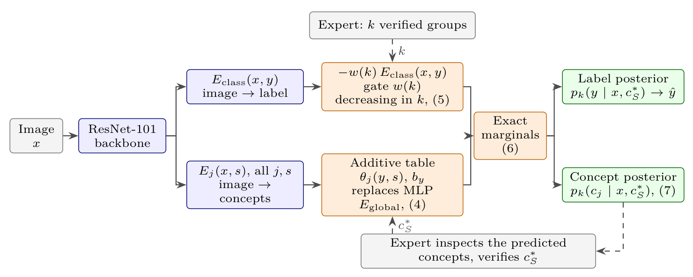
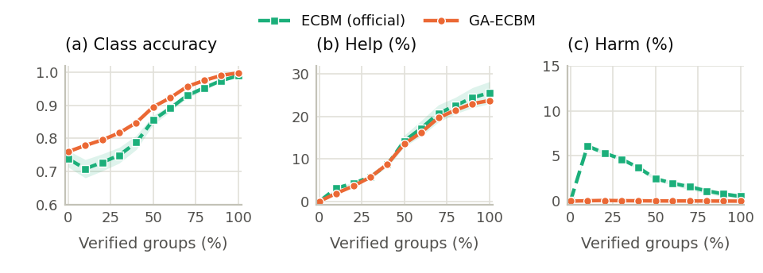
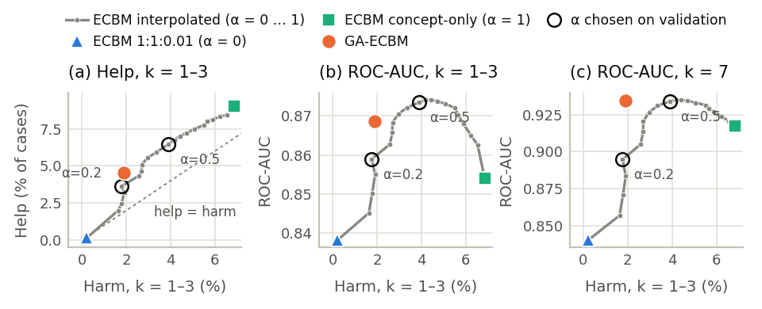

# GA-ECBM: Gated Additive Energy-Based Concept Bottleneck Models for Reliable Concept Interventions

This repo is the official implementation of our paper:

**GA-ECBM: Gated Additive Energy-Based Concept Bottleneck Models for Reliable Concept Interventions**

Huy Nhat-Le, Khanh Quoc Tran-Duong

Faculty of Information Technology, Ton Duc Thang University, Ho Chi Minh City, Vietnam

*Under submission.* [Paper: coming soon]

## Overview of GA-ECBM

<p align="center">

</p>

Concept bottleneck models let an expert correct the predicted concepts at test time, but a correction can also turn a
correct prediction into a wrong one. In the official implementation of energy-based concept bottleneck models (ECBMs),
the second intervention round predicts the label from the concepts alone, so the image evidence is discarded once a few
concepts have been verified.

GA-ECBM keeps the image and concept energies of ECBM and changes two things:

- **Additive concept–label energy.** The neural concept–label energy is replaced by a table of per-state scores,
  `E_global(c, y) = -(b_y + Σ_j θ_j(y, c_j))`. The label and concept posteriors for any set of verified concepts are then
  exact and closed-form, so no iterative energy minimization is needed.
- **Gated image evidence.** The image–label energy is multiplied by a learned gate `w(k)` that decreases with the
  number `k` of verified concept groups, so the image evidence is down-weighted instead of discarded.

Training adds a marginal-likelihood term, an intervention term and a monotonicity term to the ECBM objective.

## Installation

### Prerequisites

We ran all experiments on one NVIDIA T4 GPU (16 GB) on Kaggle. The notebooks install their own dependencies (CUB uses
PyTorch Lightning 1.6.4, as the official ECBM code). The analysis and figure scripts run on a CPU:

```bash
git clone https://github.com/LeNhatHuy219/GA-ECBM.git && cd GA-ECBM
pip install -r requirements.txt
```

### Dataset Preparation

+ [**CUB-200-2011**](https://data.caltech.edu/records/65de6-vp158)
  We use the train/val/test split and the 112 concepts of vanilla
  [CBMs](https://github.com/yewsiang/ConceptBottleneck/blob/master/CUB/README.md). The notebooks download the images and
  the processed split automatically.

+ [**Derm7pt**](http://derm.cs.sfu.ca/)
  Download the dataset from its website and attach `release_v0` (with `images/` and `meta/`) as a Kaggle dataset. We use
  the official split (413/203/395 cases); melanoma is any diagnosis starting with "melanoma". Derm7pt is licensed
  CC BY-NC-ND 4.0, so this repo contains no Derm7pt images, metadata or labels.

## Run Experiments

### 1. CUB-200-2011

GA-ECBM runs inside the official ECBM code ([xmed-lab/ECBM](https://github.com/xmed-lab/ECBM), commit `d38c43a`). For
each seed (42, 123, 2026), run the three notebooks in [`cub/notebooks/seed<seed>/`](cub/notebooks) in order:

1. `ecbm_cub*_kaggle.ipynb`: train ECBM with the official code (about 4 h);
2. `ga_ecbm_cub*_kaggle.ipynb`: train GA-ECBM (about 4 h);
3. `*score_kaggle.ipynb`: attach the outputs of steps 1 and 2 and score both models on the same intervention protocol
   (about 3 h, most of it ECBM's iterative inference).

Each notebook clones the official repository, applies [`cub/official_repo.patch`](cub/official_repo.patch) and writes
the GA-ECBM model ([`cub/ga_ecbm.py`](cub/ga_ecbm.py)) and its LightningModule
([`cub/ga_litmodel.py`](cub/ga_litmodel.py)) into it. We trained for 100 instead of 300 epochs (Kaggle session limit)
and in FP16.

### 2. Derm7pt

Run [`derm7pt/ecbm_derm7pt_paper_kaggle.ipynb`](derm7pt/ecbm_derm7pt_paper_kaggle.ipynb) (about 75 min). It trains
ECBM and GA-ECBM with seeds 42, 123, 2026, 11, 222 and 3333 on a ResNet-101 backbone, then scores the unintervened
models and all 127 subsets of the seven checklist criteria on the validation and test sets.

### 3. Tables and Figures

The outputs of our runs are in [`results/`](results). To recompute the tables and figures of the paper from them:

```bash
# CUB (Table 2)
python scripts/cub_three_seeds.py results/cub/cub_three_seeds.json \
    results/cub/seed42/results.json results/cub/seed123/results.json results/cub/seed2026/results.json

# Derm7pt: first re-attach the labels from your own copy of the dataset
python derm7pt/analysis/attach_labels.py /path/to/release_v0/meta
python derm7pt/analysis/paper_numbers.py /path/to/release_v0/meta    # Tables 3-4 and the Derm7pt numbers in the text
python derm7pt/analysis/mix_valselected.py                            # comparison with interpolated ECBM procedures

# Figures
FIG_WIDTH_IN=4.8 python scripts/make_figures.py results/derm7pt/runs.json \
    results/cub/seed42/results.json,results/cub/seed123/results.json,results/cub/seed2026/results.json figures test
FIG_WIDTH_IN=4.8 python scripts/make_mix_figure.py results/derm7pt/analysis/mix_valselected.json figures
```

`paper_numbers.py` prints each value next to the one in the paper.

## Results

### CUB-200-2011

| Model | Class | Concept | Overall concept | Intervention AUC | Harm (%) |
|---|---|---|---|---|---|
| ECBM, published (5 seeds, 300 epochs) | 0.812 ± 0.006 | 0.973 ± 0.001 | 0.713 ± 0.009 | – | – |
| ECBM, our run (3 seeds, 100 epochs) | 0.738 ± 0.025 | 0.960 ± 0.005 | 0.575 ± 0.029 | 0.844 ± 0.015 | 2.83 ± 0.21 |
| GA-ECBM (3 seeds, 100 epochs) | 0.760 ± 0.003 | 0.965 ± 0.001 | 0.651 ± 0.006 | **0.886 ± 0.003** | **0.03 ± 0.01** |

Test set. Harm is the share of all images turned from correct to wrong by an intervention, averaged over 10–100% of the
groups verified. Without intervention, GA-ECBM was higher in every seed, but no difference is significant after Holm
correction over three seeds.

<p align="center">

</p>

Verifying 10% of the concept groups lowered ECBM's accuracy (0.738 → 0.709) and turned 6.1% of the images from correct
to wrong. GA-ECBM's accuracy rose with every level in every seed, and its harm never exceeded 0.12%.

### Derm7pt

| Procedure | ROC-AUC, no intervention | ROC-AUC, all 7 verified | Macro F1, all 7 verified | Help, 1–3 verified (%) | Harm, 1–3 verified (%) |
|---|---|---|---|---|---|
| ECBM (1:1:0.01) | 0.837 ± 0.012 | 0.840 ± 0.014 | 0.729 ± 0.016 | 0.1 ± 0.2 | 0.2 ± 0.5 |
| ECBM (concept-only) | 0.837 ± 0.012 | 0.917 ± 0.005 | 0.817 ± 0.012 | 9.0 ± 1.9 | 6.9 ± 1.6 |
| GA-ECBM | 0.839 ± 0.019 | **0.934 ± 0.007** | **0.849 ± 0.011** | 4.5 ± 1.3 | 1.9 ± 0.7 |

Test set, six seeds. The two ECBM rows share one model and differ in how a correction is propagated. ECBM (1:1:0.01)
keeps all three energies with the weights used for prediction; ECBM (concept-only) predicts from the concepts alone after
a correction, like the official second intervention round.

<p align="center">

</p>

Without intervention the two models performed alike. Compared with the concept-only procedure, GA-ECBM harmed fewer
cases and reached a higher ROC-AUC with all criteria verified, but it also corrected fewer cases, so the net benefit for
one to three verified criteria was similar (2.66 versus 2.15 points).

<p align="center">

</p>

Interpolating the two ECBM procedures traces a help–harm trade-off (gray). At the same harm, GA-ECBM helped more cases;
at the same net benefit, it harmed about half as many.

## Repository Structure

```
cub/
  ga_ecbm.py, ga_litmodel.py       GA-ECBM for the official ECBM code
  official_repo.patch              our edits to xmed-lab/ECBM
  notebooks/seed{42,123,2026}/     Kaggle notebooks (train ECBM, train GA-ECBM, score)
derm7pt/
  ecbm_derm7pt_paper_kaggle.ipynb  ECBM and GA-ECBM on Derm7pt (6 seeds)
  analysis/                        statistics, interpolation analysis, label re-attachment
scripts/                           CUB aggregation and figures
results/                           metrics, intervention curves, per-case predictions and logs of our runs
figures/                           figures of the paper
```

The notebooks are the exact versions we ran; their comments are in Vietnamese, and
[`cub/README.md`](cub/README.md) and [`derm7pt/README.md`](derm7pt/README.md) describe each section in English. The
Derm7pt per-case predictions in `results/derm7pt/per_case/` contain model outputs only;
`derm7pt/analysis/attach_labels.py` adds the labels from your copy of the dataset. Model checkpoints are not included.

## Reference

```bib
@misc{GAECBM,
      title={GA-ECBM: Gated Additive Energy-Based Concept Bottleneck Models for Reliable Concept Interventions},
      author={Nhat-Le, Huy and Tran-Duong, Khanh Quoc},
      year={2026},
      note={Under submission}
}
```

## Acknowledgement

This code builds on the official [ECBM](https://github.com/xmed-lab/ECBM) implementation (MIT License) and the CUB
preprocessing of [Concept Bottleneck Models](https://github.com/yewsiang/ConceptBottleneck). Our code is released under
the MIT License; see [`LICENSE`](LICENSE) and [`THIRD_PARTY_NOTICES.md`](THIRD_PARTY_NOTICES.md).
